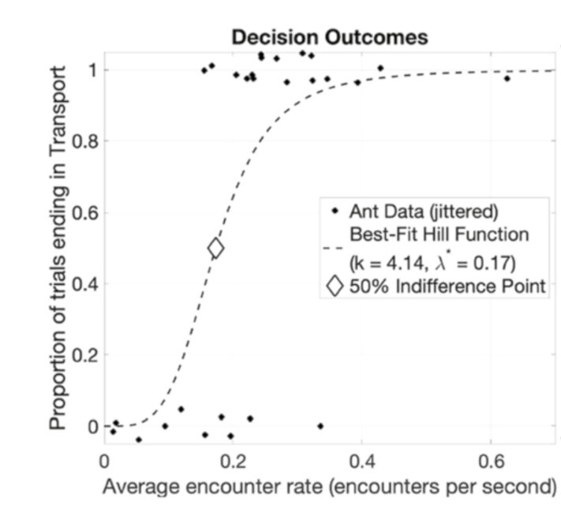
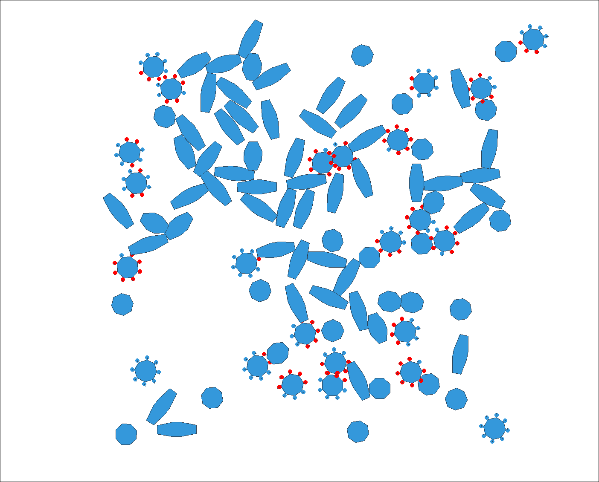
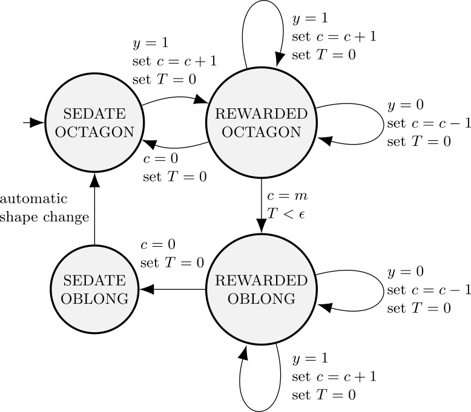
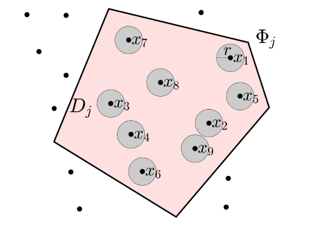
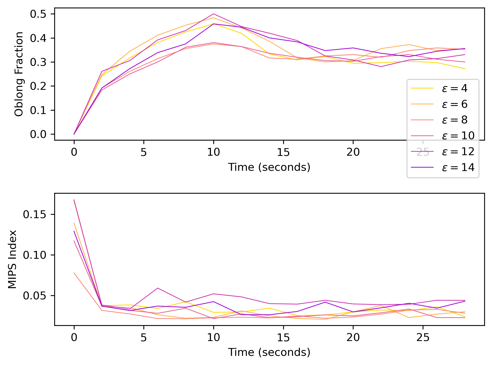
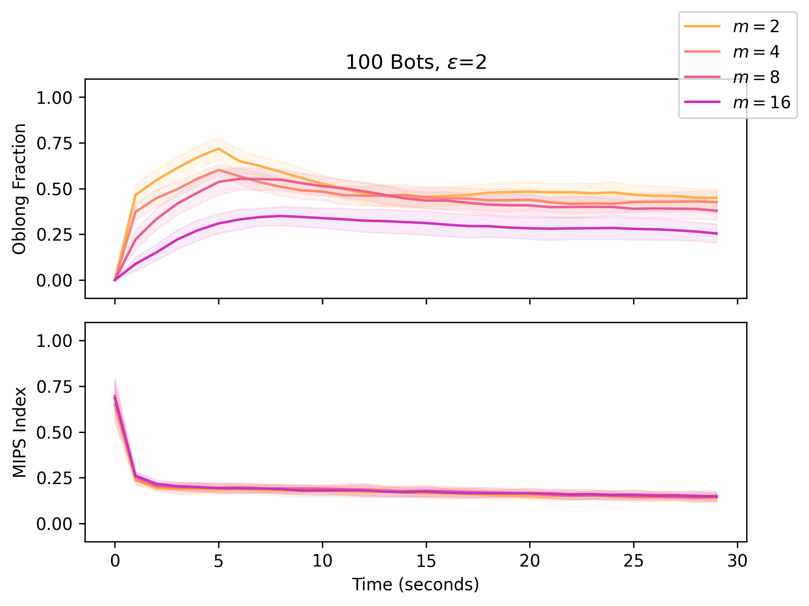
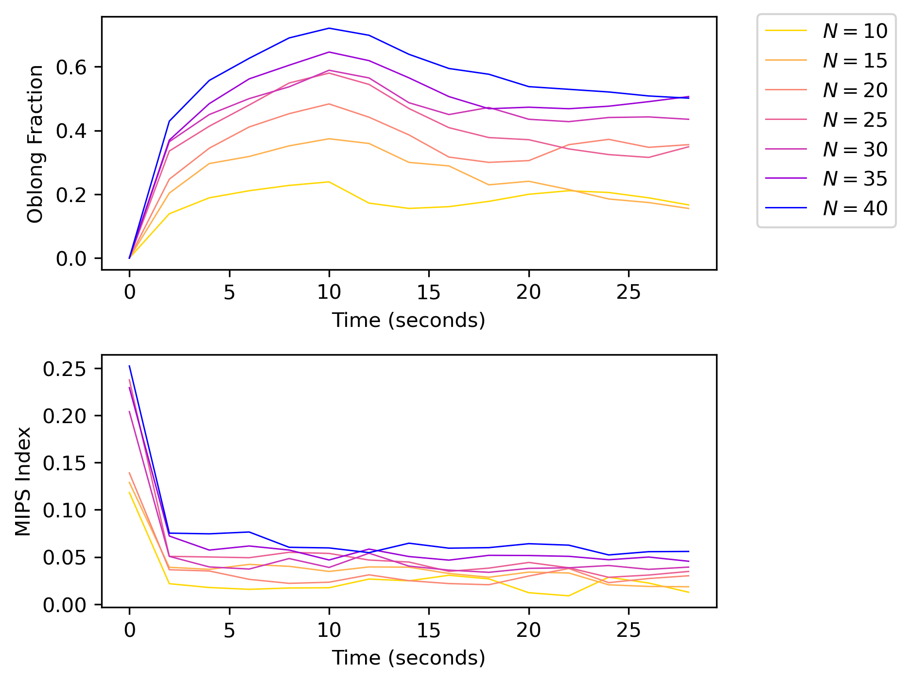
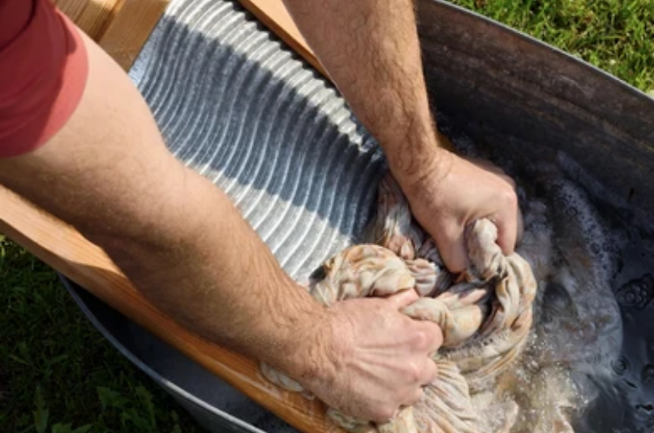
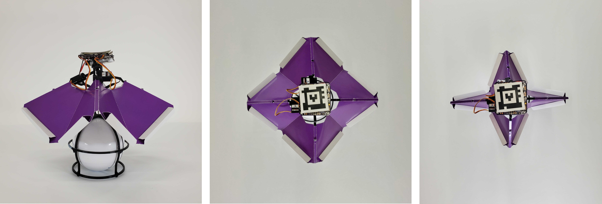

# Resource-Constrained Shape-Changing Robots {class="center"}

## Motivation: Shape-Changing Micro-Robots

:::::::::::::: {.columns align=center}
::: {.column width="60%"}

> - Mechanisms include magnetism, bistable mechanisms, electrofluidics, many others
> - Often, uniform global controls
> - Often, strong influence from Brownian dynamics
> - Why change shape?
>    - Drug delivery
>    - Collective dynamics (align, aggregate)

:::
::: {.column width="40%"}

{width=100% class="center"}

:::
::::::::::::::

## Motivation: Quorum Sensing without Deliberation

:::::::::::::: {.columns align=center}
::: {.column width="50%"}

> - Externalize computation of density estimation to random walk
> - Strong evidence of effective strategies in biological systems
> - Minimizing onboard resources: no pheromones or explicit communication

:::
::: {.column width="50%"}

{width=90%}

:::
::::::::::::::

## Motivation: Deliberate Collisions

:::::::::::::: {.columns align=center}
::: {.column width="50%"}

> - Collisions for efficient redirection
> - Localization in dense swarms
> - Task allocation
> - Measuring aggregation: Motility induced phase separation (MIPS)

:::
::: {.column width="50%"}

{width=100% class="center"}

:::
::::::::::::::

# Our Scenario {class="center"}

## Assumptions

> - "Wild body" motion: no explicit motion model
> - Agents will eventually explore everywhere (2D bounded environment)
> - Robots have two possible shapes, can change shape individually

{width=40% class="center"}

## Research Questions

Can we control the proportion of the collective in each shape using local decisionmaking?

. . .

What effect does shape have on collective dynamics?

## Proposed Algorithm

> - Intuition: collisions "reward" robots and increase likelihood of shape change
> - Collision happens within $\epsilon$: increment counter
> - Elapsed time without collision exceeds $\epsilon$: decrement counter
> - Change shape when counter reaches $m$ (fully rewarded)
> - Change back when counter reaches $0$ (fully sedate)

## Proposed State Machine

{width=70% class="center"}

## Resources Required

> - Collision, proximity, or contact sensor(s)
    - Edge trigger to classify contact as *new*
> - One integer counter
> - One timer
> - Two binary state variables

# Analysis {class="center"}

## Population Dynamics

\begin{align*}
\dot{R} & = S \lambda - R/\tau \\
\dot{S} & = R/\tau - S \lambda
\end{align*}

> - $S$, $R$ represent population fractions ($S + R = 1$)
> - $\lambda$ is transition rate from shape 1 to shape 2
> - $\tau$ is related to transition rate back to shape 1

## Probability of Collision

:::::::::::::: {.columns align=center}
::: {.column width="50%"}

> - To determine transition rate, need to understand probability of collision
> - Depends on local density, robot size, robot speed
> - Well-mixed (AKA mean field) assumption allows use of Poisson point process

:::
::: {.column width="50%"}

{width=100% class="center"}

:::
::::::::::::::

## Density Predictions

Probability of collisions gives:

> 1. $\lambda$: probability of $m$ sequential collisions with less than $\epsilon$ elapsed time between them
> 2. $\tau$: probability of no collisions within $m\epsilon$ time

# Results {class="center"}

## Low Sensitivity to Timer Threshold $\epsilon$ in Dense Settings

{width=80% class="center"}

## Effect of Counter Threshold $m$

{width=80% class="center"}

## High Sensitivity to Density with Fixed $m$ and $\epsilon$

{width=80% class="center"}

## Demonstration

{width=90% class="center"}

# Dirty Laundry and Next Steps {class="center"}

## Dirty Laundry

> - MIPS normalization and discrete computation
> - Radius assumptions
> - Hardware experiments inconclusive
>    - Weaselball fail
>    - Micro-robot physics vary widely

{width=40% class="center"}

## Next Steps

> - Developing theory of robot "cross-section"
> - Randomized navigation of dense swarms in dense obstacle fields
> - Hardware validation and robophysics (publishing our shape-change mechanism)

. . .

{width=80% class="center"}

## Contributions

> - Open-source simulator and hardware
> - Useful approach for distributed adaptation to density change, supported by theory
> - Hints at fun problem structure to improve theory

## Thank you! Questions?

New lab website: [https://mrrp.cs.wwu.edu](https://mrrp.cs.wwu.edu)
